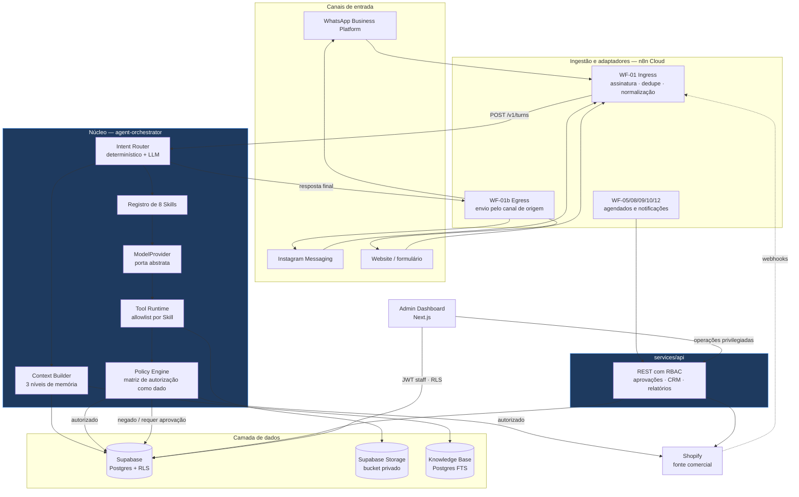
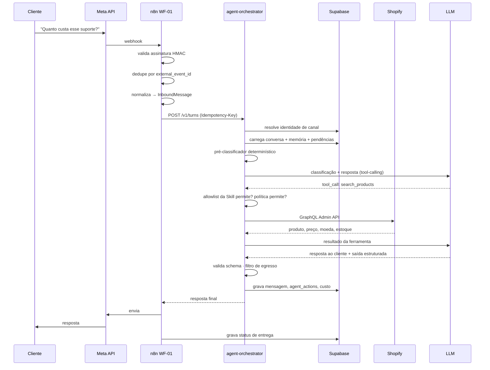

# 01 — Validação da arquitetura

Responde ao pedido **(1) Valide a arquitetura proposta**.

---

## 1. Avaliação ponto a ponto

### 1.1 Decisões validadas sem alteração

| Decisão do documento mestre | Seção | Veredito | Justificativa técnica |
|---|---|---|---|
| Agente central + 8 Skills como módulos, não 8 agentes autônomos | § 4.3 | ✅ **Aprovado** | Multiagente autônomo multiplica chamadas de LLM, latência e não-determinismo, e torna a atribuição de responsabilidade por um erro quase impossível. Um roteador + módulos de instrução dá o mesmo resultado funcional com custo e superfície de falha muito menores. Decisão correta e madura. |
| Modelo nunca recebe credenciais nem acesso direto ao banco | § 4.4, § 7 | ✅ **Aprovado** | Única postura defensável. É o que separa "assistente com ferramentas" de "RCE com interface de chat". |
| Autorização no backend, não no prompt | § 8 | ✅ **Aprovado** | Prompt é mitigação, não controle. Ver porém **C1** (§ 1.3) sobre *onde* no backend. |
| Shopify como fonte da verdade comercial; cache nunca é verdade | § 13.1, § 25.2 | ✅ **Aprovado** | Elimina a classe de erro mais caro em comércio: afirmar preço ou estoque errado. |
| Falha de integração → informar impossibilidade, nunca inventar | § 17.1, § 26.6 | ✅ **Aprovado** | Define o comportamento em degradação *antes* de existir código, o que é raro e valioso. |
| HITL obrigatório para orçamento, vinculado à versão | § 8.1, § 25.3 | ✅ **Aprovado** | Ver reforço em **C4** (§ 1.3). |
| Atena não pode aprovar a própria solicitação | § 8.1 | ✅ **Aprovado** | Precisa de constraint de banco, não só de regra de aplicação. Detalhe em `04-data-model.md` § 5.2. |
| Precedência explícita de fontes de informação | § 11.2 | ✅ **Aprovado** | Transformável em código verificável. Implementação em `06-skills-specification.md` § 5. |
| Arquivos de cliente em bucket privado, com checksum e URL assinada | § 12.3 | ✅ **Aprovado** | Correto. Pipeline completo em `07-security-and-permissions.md` § 6. |
| Idempotência em webhooks e escritas | § 17.2 | ✅ **Aprovado** | Design concreto em `04-data-model.md` § 4 e `08-n8n-workflows.md` § 3. |
| Separação de ambientes dev/homologação/produção | § 9.7, § 16.1 | ✅ **Aprovado** | Inclui projetos Supabase separados e loja de desenvolvimento Shopify separada. |
| Fora de escopo inicial (desconto, reembolso, cancelamento, parecer clínico) | § 1.5 | ✅ **Aprovado** | Lista correta e bem escolhida. Implementada como *deny list* em dados, não em prompt. |

### 1.2 Decisões validadas com ressalva

| Decisão | Seção | Ressalva | Ação |
|---|---|---|---|
| OpenAI API como provedor | § 21 | É **RECOMENDAÇÃO**, marcada A DEFINIR em § 24. Contratos de *structured output* (modo estrito de JSON Schema), *prompt caching* e preço por token diferem entre provedores, e o desenho das Skills depende disso. | Isolar atrás de uma porta `ModelProvider` (ADR-003) para que a Fase 1 não fique bloqueada por **Q-01**. |
| Supabase como banco + auth + storage | § 10, § 21 | Boa escolha para o escopo. Dois pontos: (a) `service_role` concentra poder total — precisa ficar exclusivamente no orquestrador; (b) RLS tem alcance limitado aqui, ver **C3**. | Aprovado com as mitigações de `07-security-and-permissions.md` § 3. |
| Next.js para o painel | § 21 | Adequado. Ressalva: o painel **não deve** falar com o Supabase usando `service_role`, e aprovações **não devem** ser `UPDATE` direto de tabela pelo cliente. | Painel lê via Supabase Auth + RLS; escreve operações privilegiadas via `services/api`. ADR-007. |
| Busca textual primeiro, vetorial depois | § 11.3 | Correto e econômico. Postgres FTS (`tsvector`) resolve bem até alguns milhares de documentos. | Aprovado. `pgvector` fica como extensão planejada, não implementada na v1. ADR-011. |
| Formatos de arquivo STL/STEP/3MF/OBJ/PDF/PNG/JPG | § 12.2 | Aceitável, com a observação de que **nenhum deles deve ser parseado na v1**. Parsers de CAD e de PDF são superfície de ataque conhecida. | Armazenar, calcular checksum, nunca abrir programaticamente na v1. ADR-012. |
| KPIs definidos em § 18 | § 18 | Excelente lista. Ressalva: várias métricas ("respostas sem fonte quando fonte era necessária", "preços incorretos") só são mensuráveis se houver instrumentação desenhada *junto* com a feature. | Instrumentação entra na definição de pronto de cada Skill, não depois. |

### 1.3 Correções propostas (discordâncias)

Cada item abaixo é um ponto onde este blueprint **discorda** do documento mestre.
Nenhuma é aplicada sem sua aprovação; o documento mestre permanece a fonte da
verdade até ser formalmente atualizado (§ 0.4).

---

#### C1 — Inverter o papel do n8n no caminho crítico (ADR-002)

**O que o documento diz.** § 9.1 descreve o WF-01 como 17 passos dentro do n8n,
incluindo "10. Validar saída estruturada", "11. Validar autorização da ação" e
"12. Executar ferramenta autorizada".

**Por que isso é um problema.**

1. **Contradiz § 4.4.** A própria tabela de separação de responsabilidades diz
   "n8n: orquestrar workflows e integrações — *não deve* confiar cegamente em
   saída do modelo" e "Backend: validar autorização, esquema, identidade e
   regras". Colocar a validação de autorização em nós de n8n move o controle de
   segurança para fora do backend.
2. **Não é testável em CI.** Lógica de autorização em nós visuais de n8n não tem
   teste unitário, não tem cobertura, e um diff de workflow exportado em JSON é
   praticamente irrevisável em pull request. A § 19.3 exige "todas as operações
   críticas terem testes de autorização" — inviável nesse desenho.
3. **Latência.** Cada nó é um salto. Um turno conversacional com recuperação de
   contexto, chamada de LLM, chamada de ferramenta e segunda chamada de LLM
   atravessa o motor de workflow várias vezes.
4. **Depuração.** Rastrear um erro de produção através de 17 nós, sem stack trace
   e sem tipos, é significativamente mais lento do que em um serviço tipado.

**Proposta.** Fronteira de responsabilidade redesenhada:

| Responsabilidade | Onde | Por quê |
|---|---|---|
| Receber webhook, validar assinatura, deduplicar, normalizar | **n8n** | É exatamente o que n8n faz bem, e a equipe de operação pode ajustar adaptadores de canal sem deploy. |
| Turno conversacional: contexto → política → LLM → ferramenta → autorização → resposta | **`agent-orchestrator`** (serviço tipado) | É o núcleo de segurança e de comportamento. Precisa de tipos, testes, cobertura e revisão em PR. |
| Enviar a resposta pelo canal de origem | **n8n** | Adaptador de canal. Mesma razão da ingestão. |
| Agendados: relatório diário, follow-up, alerta de estoque, retenção | **n8n** | Caso de uso ideal: visível, editável pela operação, sem deploy. |
| Aprovação humana (notificação, lembretes, roteamento) | **n8n** + API | n8n notifica; a decisão é gravada pela API com RBAC. |
| DLQ e tratamento central de erro | **n8n** | Bom suporte nativo. |

O WF-01 passa de 17 nós para ~7, com **uma** chamada a `POST /v1/turns`.

**O que se perde.** A equipe de operação deixa de poder ajustar o comportamento do
agente sem um deploy. Avalio isso como ganho, não perda: comportamento de agente
que toca preço, dados pessoais e autorização *deve* passar por revisão de código.

**Alternativa se você discordar.** Manter o desenho do documento, mas então o
WF-01 precisa chamar um endpoint `POST /v1/authorize` para *toda* ação antes de
executá-la, e os nós de n8n não podem conter nenhuma lógica condicional sobre
permissão. É mais frágil, mas auditável. Decisão sua.

---

#### C2 — Roteamento determinístico para intenções de risco (ADR-004)

**O que o documento diz.** § 6.2 define `confidence` na saída estruturada e § 6.3
diz "baixa confiança: fazer pergunta objetiva ou encaminhar". O próprio documento
observa que `confidence` "é uma estimativa do modelo, não uma prova de correção".

**O problema.** Se `confidence` participa do gate, um LLM que erra com confiança
alta (o caso comum) passa direto. Para `refund_request`, `human_request` e pedido
de desconto, o custo do falso negativo é um cliente frustrado ou uma concessão
comercial indevida.

**Proposta — roteamento em três camadas, avaliadas em ordem:**

1. **Camada determinística (pré-LLM).** Padrões de alta precisão disparam rota
   fixa, independentemente do que o modelo disser depois:
   - pedido explícito de humano → `human_request`, escalonamento imediato;
   - vocabulário de reembolso/devolução/estorno → `refund_request`, política restritiva;
   - vocabulário de desconto/cupom/abatimento → marca `discount_requested`, bloqueio de alteração de preço;
   - padrão de número de pedido → exige verificação de identidade antes de qualquer consulta.
   Esses padrões são **dados versionados** (`config/intent-rules/*.yaml`), em PT e EN, com teste para cada um.
2. **Camada de classificação por LLM.** Intenção primária + secundárias, idioma,
   entidades. `confidence` é registrado como telemetria e **nunca** como gate.
3. **Camada de política (pós-LLM, determinística).** A matriz de autorização
   (§ 8) é consultada como dado. Se a ação requer aprovação ou é bloqueada, a
   decisão do modelo é irrelevante — o orquestrador recusa.

Com isso, `confidence` baixa tem um único efeito: preferir uma pergunta de
esclarecimento a uma suposição. Nunca libera nem bloqueia uma operação.

---

#### C3 — RLS não protege o caminho conversacional (ADR-006)

**O que o documento diz.** § 10.6: "Ativar Row Level Security nas tabelas
expostas. Definir políticas por usuário, papel e vínculo com registro."

**O problema.** RLS no Postgres avalia o *papel do conector* e os claims do JWT.
No caminho conversacional não existe JWT de cliente: quem chega é um número de
WhatsApp. O orquestrador se conecta com `service_role`, que por definição
**ignora RLS**. Portanto:

> O RLS, como descrito, **não protege** o isolamento entre clientes no atendimento.
> Ele protege o painel administrativo.

Se a equipe acreditar o contrário, o requisito "cliente tenta acessar outro
pedido → bloqueia" (§ 19.1) e o teste "tentativa de acessar pedido de outro
cliente" (§ 19.2) ficam sem mecanismo responsável.

**Proposta — dois perímetros distintos, nomeados:**

| Perímetro | Protegido por | Mecanismo |
|---|---|---|
| **Staff / painel** | RLS + RBAC | Supabase Auth, claims de papel no JWT, políticas por tabela. Painel nunca usa `service_role`. |
| **Conversacional / cliente** | Scoping obrigatório no orquestrador | Toda leitura de dado de cliente passa por uma camada de repositório que **exige** `customer_id` resolvido e verificado. Sem `customer_id` no contexto de execução, a query nem é montada. |

Reforços para o segundo perímetro:
- Uma única camada de acesso a dados (`packages/data-access`); proibido montar SQL
  ad hoc em outro lugar. Verificado por regra de lint e por revisão.
- Toda consulta que retorna dado de pedido exige `identity_verification_level`
  mínimo no contexto (ver `07-security-and-permissions.md` § 2.3).
- Teste de segurança obrigatório: tentar ler recurso do cliente B com contexto do
  cliente A, para cada ferramenta de leitura. Falha o build.
- RLS **também** é ativado nas tabelas de cliente, como defesa em profundidade,
  com negação por padrão — mesmo que o `service_role` passe por cima. Isso protege
  contra o erro futuro de alguém apontar o painel direto para essas tabelas.

---

#### C4 — Aprovação vinculada a hash de conteúdo (ADR-009)

**O que o documento diz.** § 10.3 (`quote_approvals`): campos `quote_id` e
`quote_version`; "A aprovação deve estar vinculada à versão exata do orçamento."

**O problema.** O vínculo depende de que ninguém faça `UPDATE` em `quotes` sem
incrementar `version`. É uma regra de disciplina, não uma garantia. Um bug no
painel, um script de correção ou um merge malfeito quebra a cadeia de aprovação
silenciosamente — e a Atena envia uma proposta com preço diferente do aprovado.

**Proposta.**
- `quotes` é **append-only**: `UPDATE` em `amount`, `currency`, `scope`,
  `lead_time`, `conditions` é bloqueado por trigger. Mudança cria nova linha com
  `version = version + 1` e `supersedes_quote_id`.
- Coluna gerada `content_hash` = SHA-256 canônico de
  `(scope, amount, currency, lead_time, conditions, project_id)`.
- `quote_approvals.approved_content_hash` é **NOT NULL** e tem FK composta para
  `quotes(id, content_hash)`.
- A ferramenta `send_approved_quote` recalcula o hash no momento do envio e compara.
  Divergência → recusa e alerta de incidente.

Resultado: alterar um orçamento aprovado é *impossível sem invalidar a aprovação*,
por construção. Não depende de ninguém lembrar.

---

#### C5 — Identidade de cliente como entidade de primeira classe (ADR-005)

**O que o documento diz.** § 10.2: `CUSTOMERS ||--o{ CONVERSATIONS`. `customers`
tem `shopify_customer_id`, `email`, `phone` como colunas opcionais.

**O problema.** O mesmo ser humano aparece como:
- um `wa_id` no WhatsApp (que **não** é necessariamente o telefone exibível);
- um IGSID no Instagram (opaco, não correlacionável a telefone ou e-mail);
- um `customer_id` na Shopify, com e-mail;
- possivelmente um e-mail diferente no formulário do site.

Sem uma camada de identidade, só há dois desfechos, ambos ruins: ou fundimos
registros por heurística e eventualmente **mostramos o pedido de uma pessoa para
outra**, ou duplicamos tudo e o CRM perde valor.

**Proposta.** Tabela `channel_identities` (um cliente, N identidades de canal),
com `verification_status` por identidade e um processo explícito de vinculação
que exige verificação antes de unificar históricos. Detalhe em
`04-data-model.md` § 2.2 e § 3.1.

Consequência direta: o requisito § 19.1 "cliente tenta acessar outro pedido →
bloqueia" passa a ter um mecanismo concreto — a identidade do canal precisa estar
`verified` **e** vinculada ao cliente dono do pedido.

---

## 2. Arquitetura proposta

### 2.1 Diagrama de contexto (revisado)

Mantém a intenção do § 4.2, com a fronteira do **C1** aplicada.

Os blocos destacados (`agent-orchestrator`, `services/api`) formam a **fronteira de
confiança**: é onde autorização é decidida e onde segredos existem. Nada fora deles
toma decisão de permissão.

### 2.2 Fluxo de um turno conversacional

### 2.3 Orçamento de latência

O documento não define SLA técnico de resposta. Proposta para aprovação
(**Q-05**), com base na expectativa de usuário de WhatsApp:

| Etapa | p50 alvo | p95 alvo |
|---|---|---|
| Ingestão n8n (assinatura, dedupe, normalização) | 150 ms | 400 ms |
| Resolução de identidade + contexto (2–4 queries) | 120 ms | 350 ms |
| Pré-classificação determinística | 5 ms | 15 ms |
| Chamada LLM principal | 1.200 ms | 3.000 ms |
| Ferramenta Shopify (quando houver) | 400 ms | 1.200 ms |
| Segunda chamada LLM (pós-ferramenta) | 900 ms | 2.200 ms |
| Validação, persistência, egresso | 200 ms | 500 ms |
| **Total até mensagem visível** | **~3,0 s** | **~8,1 s** |

Decisões de desenho que esse orçamento impõe:

1. **Uma chamada de LLM quando não há ferramenta.** Classificação e resposta na
   mesma chamada, com a intenção como campo da saída estruturada. Duas chamadas
   sequenciais só quando há ferramenta no meio.
2. **Prompt caching é requisito, não otimização.** O prefixo (core + Skill +
   catálogo de ferramentas) é grande e repetido a cada turno. Sem cache, custo e
   latência sobem de forma desproporcional. Isso influencia **Q-01**.
3. **Acima de 8 s, enviar um reconhecimento.** "Estou verificando essa informação,
   um momento." Enviado pelo n8n, não pelo modelo, e registrado como mensagem.
4. **Recuperação de contexto em paralelo.** Identidade, memória de conversa,
   memória de cliente e KB são I/O independente.

### 2.4 Modos de degradação

Operacionaliza § 17.1 e § 26.6.

| Dependência indisponível | Comportamento | Nunca |
|---|---|---|
| Shopify | "Não consegui verificar essa informação agora." Registra falha, oferece retorno **sem prometer prazo não configurado**. | Nunca usar cache ou memória do modelo como preço/estoque atual. |
| Supabase | Recusa o turno. Mensagem de indisponibilidade pelo canal; evento preservado na DLQ do n8n para reprocessamento. | Nunca responder sem persistir, nem perder o evento. |
| Provedor de LLM | Retry com backoff; se persistir, escalonamento automático para humano com o contexto disponível. | Nunca responder com template genérico que simule compreensão. |
| Meta / canal | Marca mensagem como `failed`, registra, não declara sucesso. WF-11 trata. | Nunca declarar entrega não confirmada. |
| Storage | Recusa o upload com mensagem clara; projeto continua sem o arquivo, campo marcado como pendente. | Nunca confirmar recebimento de arquivo não persistido. |

### 2.5 Multi-intenção

§ 6.3 exige "resolver por prioridade e contexto, sem perder solicitações
secundárias" — requisito frequentemente ignorado na prática. Desenho:

- A saída estruturada traz `intents: [{intent, priority}]`, não um único campo.
- Intenções não atendidas no turno vão para `conversation_state.pending_asks`
  (JSONB, versionado).
- `pending_asks` entra no contexto do turno seguinte, e o core tem instrução
  explícita de retomá-las.
- O painel exibe pendências abertas por conversa — a equipe vê o que a Atena deixou
  em aberto.
- Teste de aceitação: mensagem com duas intenções (preço + prazo de entrega) deve
  resultar em duas respostas ao longo da conversa, nenhuma perdida.

---

## 3. Riscos arquiteturais

| # | Risco | Prob. | Impacto | Mitigação | Dono |
|---|---|---|---|---|---|
| R1 | Vazamento de dado entre clientes por identidade mal resolvida | Média | **Crítico** (GDPR + confiança) | ADR-005 + ADR-006; verificação obrigatória antes de unificar; suíte de teste de acesso cruzado no CI | Eng. |
| R2 | Revisão de app da Meta atrasa ou é negada | Média | Alto (Fase 5 bloqueada) | Iniciar descoberta na Fase 0; provar valor interno via painel antes do canal público | Negócio |
| R3 | Conta/plano Shopify não suporta operação assumida (checkout, draft order) | Média | Alto (Fase 3) | Verificar capacidades reais na Fase 0, antes de desenhar; **não presumir** (§ 7.1) | Eng. + Negócio |
| R4 | Custo de LLM acima do previsto | Média | Médio | Prompt caching obrigatório; teto de tokens por turno; custo por conversa em telemetria desde a Fase 1; alerta de orçamento | Eng. |
| R5 | Prompt injection via documento da KB ou arquivo de cliente | Média | Alto | Separação instrução/conteúdo; allowlist de ferramenta por Skill no servidor; nenhum parser de arquivo na v1; filtro de egresso | Eng. |
| R6 | Orçamento enviado divergente do aprovado | Baixa | **Crítico** (financeiro + legal) | ADR-009 (hash); verificação no envio; auditoria imutável | Eng. |
| R7 | Alucinação de política comercial inexistente (§ 24 tem 20 itens A DEFINIR) | **Alta** | Alto | Core instruído a tratar política ausente como desconhecida; KB só retorna documento `approved`; teste de eval específico por política pendente | Eng. + Negócio |
| R8 | Lógica crítica presa no n8n, sem teste nem revisão | Alta se C1 recusado | Alto | ADR-002 | Eng. |
| R9 | Dado de saúde (órteses) tratado sem base legal | Média | **Crítico** (categoria especial, GDPR art. 9) | Q-04: captar interesse e encaminhar, zero dado clínico, até DPIA concluída | Negócio + Jurídico |
| R10 | `service_role` do Supabase exposto no painel ou em n8n | Média | **Crítico** | Chave existe só no orquestrador; painel usa Auth+RLS; varredura de segredo no CI; rotação documentada | Eng. |

R7 merece destaque: com 20 itens de política marcados **A DEFINIR** em § 24, o
comportamento mais provável de um LLM é preencher a lacuna com algo plausível. A
defesa não é só instrução no prompt — é a KB retornar vazio e o core ter um
caminho explícito de "não tenho essa política documentada, vou encaminhar".

---

## 4. O que ficou sem resposta no documento mestre

Lacunas que não são "A DEFINIR de negócio" (§ 24), mas omissões técnicas que
precisam de decisão arquitetural. Catalogadas em `02-open-decisions.md`.

| Lacuna | Onde deveria estar | Tratada em |
|---|---|---|
| Como um `wa_id` ou IGSID se torna um `customer` confiável | § 10.3 | ADR-005, Q-02 |
| Método concreto de verificação de identidade para consulta de pedido | § 13.3 ("método aprovado", sem definir) | `07` § 2.3, **Q-02** |
| SLA técnico de latência de resposta | § 18 (tem SLA de atendimento, não técnico) | § 2.3 acima, **Q-05** |
| Política de retry, timeout e circuit breaker por integração | § 17.1 ("conforme política de retry", sem definir) | `08` § 4, **Q-06** |
| Estratégia de versionamento de prompt e de rollback de comportamento | § 9.7 (versiona workflow, não prompt) | `06` § 6, ADR-010 |
| Como medir "resposta sem fonte quando fonte era necessária" (§ 18.4) | § 18.4 | `09` § 4.3 (harness de eval) |
| Conteúdo de mensagem: cifrado em repouso? pseudonimizado? | § 10.3 ("content ou referência segura") | `07` § 5, **Q-07** |
| Janela de 24 h do WhatsApp e templates para follow-up | § 14.1 cita, § 7.4 não modela | `04` § 2.9, `08` § 2.8 |
| Modelo de execução de relatórios: LLM gera números ou só narra? | § 5.8, § 9.5 | **Resolvido:** cálculo determinístico em SQL; LLM apenas narra. ADR-008 |
