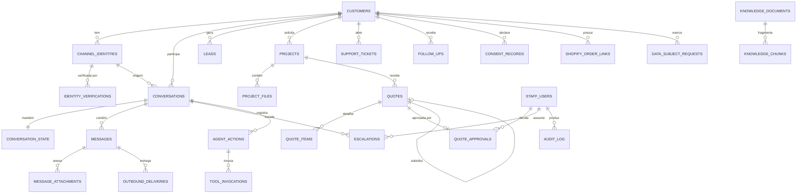
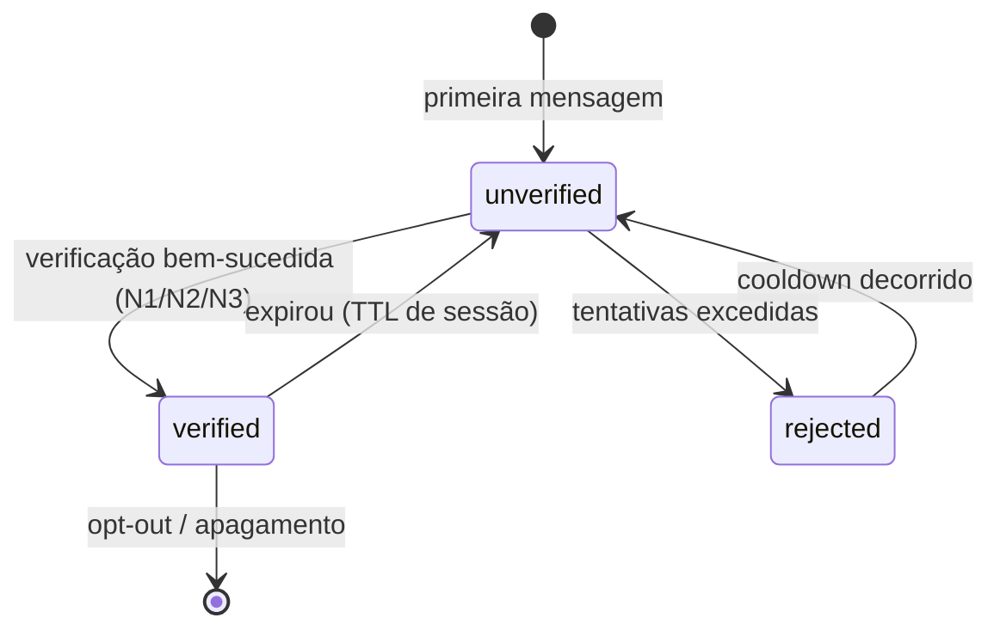
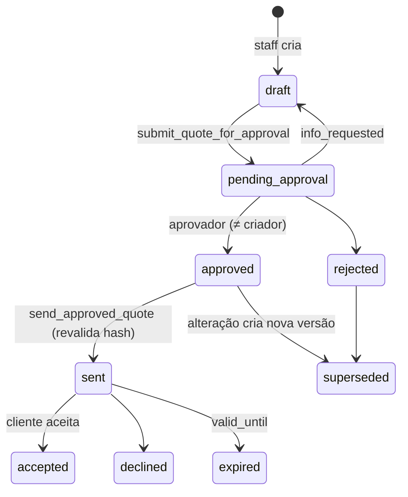

# 04 — Modelo de dados

Responde ao pedido **(4) Proponha o modelo de dados**.

Base: § 10 do documento mestre (15 tabelas), estendida para 24 tabelas pelas
razões justificadas em § 1.2 abaixo. Postgres via Supabase.

---

## 1. Visão geral

### 1.1 Tabelas de § 10 mantidas

`customers`, `conversations`, `messages`, `leads`, `projects`, `project_files`,
`quotes`, `quote_approvals`, `support_tickets`, `follow_ups`, `agent_actions`,
`knowledge_documents`, `staff_users`, `consent_records`, `integration_events`.

### 1.2 Tabelas adicionadas, com justificativa

| Tabela | Por que § 10 não basta sem ela |
|---|---|
| `channel_identities` | Um cliente chega por `wa_id`, IGSID, e-mail e Shopify com IDs distintos. Sem esta tabela, ou fundimos pessoas erradas (vazamento) ou duplicamos clientes (CRM inútil). **ADR-005 / C5.** |
| `identity_verifications` | § 13.3 exige verificação antes de divulgar dado de pedido. Precisa de registro: método, nível atingido, validade, tentativas. **Q-02.** |
| `conversation_state` | § 6.3 exige não perder intenção secundária. Precisa de um lugar para `pending_asks`, além do resumo rolante de contexto. |
| `message_attachments` | § 12.2 e § 14.2 (`attachments: []`). Anexo tem ciclo de vida próprio (scan, checksum, retenção) e não cabe em coluna de `messages`. |
| `outbound_deliveries` | § 14.3 exige tratar falha de entrega e registrar status. Entrega tem estados e retries próprios, distintos da mensagem. |
| `quote_items` | Orçamento com uma coluna `amount` não permite revisão de escopo linha a linha no painel (§ 15.5 pede escopo detalhado). |
| `escalations` | § 7.4 `escalate_to_human` precisa de entidade própria: motivo, destino, SLA, aceite. Não é um `support_ticket` (que é do cliente, não da fila interna). |
| `tool_invocations` | § 16.5 exige auditar ferramenta, recurso, resultado, request_id. Separar de `agent_actions` permite métrica de latência/erro por ferramenta sem poluir a auditoria de decisão. |
| `idempotency_keys` | § 17.2 exige idempotência em escrita. Precisa de store com resultado memoizado, não só flag. |
| `data_subject_requests` | § 16.2 exige processo para direitos dos titulares. Sem tabela, não há trilha de cumprimento de prazo legal. |
| `knowledge_chunks` | § 11.3: busca precisa de granularidade menor que documento, com `tsvector` indexado. Caminho para `pgvector` sem migration estrutural. |
| `shopify_order_links` | Vínculo verificado entre `customer` e pedido Shopify. Evita reconsultar e reverificar a cada turno, e dá trilha de quem acessou o quê. |
| `audit_log` | `agent_actions` audita a IA. Ação **humana** no painel (aprovar, reatribuir, editar cliente) precisa de trilha equivalente (§ 16.5). |

### 1.3 Diagrama ER



---

## 2. Dicionário de dados

Convenções: toda tabela tem `id UUID PK DEFAULT gen_random_uuid()`,
`created_at TIMESTAMPTZ NOT NULL DEFAULT now()`. `updated_at` onde há mutação,
mantido por trigger. Exclusão lógica (`deleted_at`) onde a retenção exige
preservar vínculo; exclusão física onde o GDPR exige apagar.

### 2.1 `customers`

| Coluna | Tipo | Nulo | Nota |
|---|---|---|---|
| `id` | uuid | não | PK |
| `display_name` | text | sim | Como o cliente se identificou. Não presumir nome legal |
| `primary_email` | citext | sim | Único quando presente, `WHERE deleted_at IS NULL` |
| `primary_phone_e164` | text | sim | Normalizado E.164. CHECK de formato |
| `shopify_customer_id` | text | sim | Único quando presente |
| `preferred_language` | text | não | `pt-BR` \| `en`. Default detectado, sobreposto por preferência explícita (§ 3.2) |
| `country_code` | char(2) | sim | ISO-3166-1. Afeta frete e moeda (**Q-14**) |
| `lifecycle_stage` | enum | não | `prospect` \| `customer` \| `inactive` |
| `merged_into_customer_id` | uuid | sim | FK self. Fusão nunca apaga: redireciona |
| `deleted_at` | timestamptz | sim | Retenção (**Q-13**) |

**Não armazenar** (§ 10.3, § 16.1): dado de cartão, senha, qualquer dado de
categoria especial. `FEATURE_HEALTH_INTAKE_ENABLED=false` (**Q-04**) garante que
nenhum campo de saúde exista na v1.

### 2.2 `channel_identities` ⭐ nova (ADR-005)

| Coluna | Tipo | Nulo | Nota |
|---|---|---|---|
| `customer_id` | uuid | sim | **Nulo é válido:** identidade existe antes de haver cliente |
| `channel` | enum | não | `whatsapp` \| `instagram` \| `website` \| `email` \| `shopify` |
| `external_id` | text | não | `wa_id`, IGSID, e-mail, `customer_id` da Shopify |
| `external_display_name` | text | sim | Nome do perfil; não confiável |
| `verification_status` | enum | não | `unverified` \| `verified` \| `rejected` |
| `verified_at` | timestamptz | sim | |
| `first_seen_at` / `last_seen_at` | timestamptz | não | |
| `opt_out_at` | timestamptz | sim | Opt-out é **por identidade de canal**, não por cliente |

`UNIQUE (channel, external_id)`.

**Regra de ouro:** uma identidade `unverified` nunca dá acesso a dado de outra
identidade do mesmo cliente. A vinculação exige verificação (§ 2.3 de `07`).
É isto que implementa "cliente tenta acessar outro pedido → bloqueia" (§ 19.1).

### 2.3 `identity_verifications` ⭐ nova (Q-02)

| Coluna | Tipo | Nota |
|---|---|---|
| `channel_identity_id` | uuid | FK |
| `method` | enum | `order_email_match` \| `order_postcode_match` \| `otp_email` \| `otp_sms` \| `shopify_session` |
| `level` | smallint | 1..3 conforme Q-02 |
| `challenge_hash` | text | **Hash** do código, nunca o código |
| `attempts` / `max_attempts` | smallint | |
| `status` | enum | `pending` \| `succeeded` \| `failed` \| `expired` |
| `expires_at` | timestamptz | |
| `scope_granted` | jsonb | O que este nível libera, materializado |
| `requested_by_conversation_id` | uuid | Trilha |

### 2.4 `conversations`

Campos de § 10.3 mantidos, com adições: `channel_identity_id` (FK, de onde veio),
`primary_language` (detectado), `priority` (`low`\|`normal`\|`high`\|`urgent`),
`handled_by` (`atena`\|`human`\|`hybrid`), `first_response_at` (para o KPI de
§ 18.1 — precisa ser coluna, não cálculo), `escalated_at`, `resolution`
(`resolved_by_atena`\|`resolved_by_human`\|`abandoned`\|`unresolved`).

### 2.5 `conversation_state` ⭐ nova

Um registro por conversa. Separado de `conversations` porque muda a cada turno.

| Coluna | Tipo | Nota |
|---|---|---|
| `conversation_id` | uuid | PK e FK |
| `rolling_summary` | text | Resumo compacto para caber no contexto |
| `summary_up_to_message_id` | uuid | Até onde o resumo cobre |
| `pending_asks` | jsonb | ⭐ Intenções secundárias não atendidas (§ 6.3) |
| `collected_fields` | jsonb | Requisitos de projeto já coletados (§ 12.1) — evita repetir pergunta (§ 3.3) |
| `asked_questions` | jsonb | Perguntas já feitas. Implementa "não repetir perguntas já respondidas" |
| `active_skill` | text | Skill do último turno |
| `identity_level` | smallint | Nível de verificação vigente nesta conversa |
| `turn_count`, `last_turn_at` | | |

`collected_fields` + `asked_questions` são o que transforma "não repita
perguntas" de instrução de prompt em garantia de dados.

### 2.6 `messages`

Campos de § 10.3, com: `channel_identity_id`, `content_redacted` (bool — se
houve redação de PII), `token_count_in`/`token_count_out`, `cost_micros`
(§ 25.6 — custo por conversa exige isto na linha), `prompt_version`,
`skill_id`, `model_id` (⭐ reprodutibilidade: saber qual prompt/modelo gerou
cada resposta), `is_template` + `template_name` (WhatsApp fora da janela de 24 h),
`in_reply_to_message_id`.

`UNIQUE (channel, external_message_id)` onde presente → dedupe natural.

Conteúdo em claro conforme **Q-07** opção A, com retenção **Q-13**.

### 2.7 `message_attachments` ⭐ nova

`message_id`, `storage_path`, `original_filename`, `mime_type_declared`,
`mime_type_detected` (⭐ detectado por *magic bytes*, não pela extensão — § 12.3),
`file_size`, `checksum_sha256`, `scan_status` (`pending`\|`clean`\|`infected`\|`skipped`\|`error`),
`scan_engine`, `scanned_at`, `is_quarantined`, `retention_delete_after`.

**Regra:** `scan_status != 'clean'` ⇒ nenhuma URL assinada é emitida, para
ninguém, inclusive staff.

### 2.8 `outbound_deliveries` ⭐ nova

`message_id`, `channel`, `provider_message_id`, `status`
(`queued`\|`sent`\|`delivered`\|`read`\|`failed`\|`suppressed`),
`failure_code`, `failure_reason`, `attempt`, `next_retry_at`,
`within_service_window` (bool — ⭐ janela de 24 h do WhatsApp),
`suppression_reason` (`opt_out`\|`outside_window_no_template`\|`no_consent`).

Separar isto de `messages` é o que permite cumprir § 14.3 ("tratar falha de
entrega", "registrar status de envio") sem mutilar o histórico de conversa.

### 2.9 `leads`

Campos de § 10.3, com: `score` (determinístico, calculado em SQL — não pelo LLM),
`score_reason` (jsonb, explicável), `estimated_value` + `currency`,
`lost_reason` (enum — § 18.2 exige "motivos de perda"), `stage_changed_at`,
`conversation_id`.

### 2.10 `projects`

Campos de § 10.3, com: `reference_code` (⭐ código legível para o cliente citar,
ex. gerado por sequência — não expor UUID em conversa), `pillar`
(`collectibles`\|`decoration`\|`utility`\|`customization`\|`engineering`),
`requirements` jsonb **validado por JSON Schema** (`project-request.schema.json`),
`missing_requirements` (jsonb — o que ainda falta, alimenta a pergunta seguinte),
`is_health_related` (bool, default false — ⭐ se true, roteamento especial e
bloqueio de coleta, **Q-04**), `technical_review_requested_at`,
`technical_reviewed_at`, `technical_notes` (interno, nunca exposto ao cliente).

### 2.11 `project_files`

Campos de § 10.3, com os mesmos reforços de `message_attachments`:
`mime_type_detected`, `is_quarantined`, `ip_sensitive` (bool, default **true** —
§ 25.5: arquivo de cliente é propriedade intelectual até prova em contrário),
`retention_delete_after` (**Q-13**), `uploaded_by` (`customer`\|`staff`),
`access_log_count`.

### 2.12 `quotes` ⭐ append-only (ADR-009 / C4)

| Coluna | Tipo | Nota |
|---|---|---|
| `project_id` | uuid | FK |
| `version` | integer | `UNIQUE (project_id, version)` |
| `supersedes_quote_id` | uuid | FK self |
| `superseded_by_quote_id` | uuid | FK self |
| `currency` | char(3) | ISO-4217 (**Q-14**) |
| `amount_total` | numeric(14,2) | ⭐ `numeric`, nunca `float` |
| `scope` | text | |
| `lead_time_days` | integer | |
| `conditions` | text | |
| `valid_until` | date | |
| `status` | enum | `draft` \| `pending_approval` \| `approved` \| `rejected` \| `sent` \| `accepted` \| `declined` \| `expired` \| `superseded` |
| **`content_hash`** | text | ⭐ `GENERATED ALWAYS AS` SHA-256 canônico de (project_id, scope, amount_total, currency, lead_time_days, conditions) |
| `created_by_staff_user_id` | uuid | FK. **NOT NULL** — orçamento é criado por pessoa, não pela Atena |
| `sent_at`, `customer_response_at` | | |

### 2.13 `quote_items` ⭐ nova

`quote_id`, `line_no`, `description`, `quantity`, `unit_price`, `line_total`
(coluna gerada), `item_type` (`material`\|`labour`\|`design`\|`finishing`\|`shipping`\|`other`).
Participa do `content_hash` do orçamento via trigger de recálculo.

### 2.14 `quote_approvals`

| Coluna | Tipo | Nota |
|---|---|---|
| `quote_id` | uuid | FK |
| `quote_version` | integer | Mantido de § 10.3 |
| **`approved_content_hash`** | text | ⭐ **NOT NULL**. FK composta `(quote_id, approved_content_hash) → quotes(id, content_hash)` |
| `decision` | enum | `approved` \| `rejected` \| `info_requested` |
| `approved_by_staff_user_id` | uuid | **NOT NULL**, FK `staff_users` |
| `decision_reason` | text | |
| `decided_at` | timestamptz | |
| `approver_role_at_decision` | text | ⭐ Papel no momento da decisão — papel muda, auditoria não |

### 2.15 `support_tickets`

Campos de § 10.3, com: `reference_code` (legível), `channel_origin`,
`sla_due_at`, `first_response_at`, `reopened_count`, `satisfaction_score`
(§ 18.1), `resolution_summary`.

### 2.16 `escalations` ⭐ nova

`conversation_id`, `customer_id`, `reason` (`customer_requested`\|`low_confidence`\|`policy_blocked`\|`complaint`\|`refund_request`\|`health_related`\|`integration_failure`\|`other`),
`requested_by` (`atena`\|`policy`\|`staff`), `target_role`, `status`
(`pending`\|`acknowledged`\|`in_progress`\|`resolved`\|`cancelled`),
`acknowledged_by_staff_user_id`, `acknowledged_at`, `context_snapshot` (jsonb —
o que a Atena sabia no momento), `customer_notified_at`.

⭐ `customer_notified_at` existe porque § 26.7 e § 8.1.8 exigem confirmar ao
cliente **somente depois** de o sistema registrar o encaminhamento.

### 2.17 `follow_ups`

`customer_id`, `conversation_id`, `type`, `scheduled_for`, `status`
(`scheduled`\|`sent`\|`cancelled`\|`suppressed`\|`failed`),
`consent_record_id` (⭐ **NOT NULL** para follow-up de natureza comercial —
sem consentimento, não existe follow-up),
`requires_template` (bool — janela de 24 h), `template_name`,
`created_by` (`atena`\|`staff`\|`system`), `suppression_reason`.

### 2.18 `consent_records`

`customer_id`, `channel_identity_id`, `purpose`
(`transactional`\|`marketing`\|`project_files_retention`\|`profiling`),
`lawful_basis` (`consent`\|`contract`\|`legitimate_interest`\|`legal_obligation`),
`status` (`granted`\|`withdrawn`\|`expired`), `granted_at`, `withdrawn_at`,
`evidence` (jsonb: texto exato apresentado, canal, timestamp),
`policy_version` (⭐ qual versão do aviso de privacidade estava vigente).

⭐ `evidence` + `policy_version` são o que torna o consentimento demonstrável —
o GDPR exige demonstrar, não apenas afirmar.

### 2.19 `agent_actions` (auditoria da IA)

Campos de § 10.3, com: `turn_id` (⭐ correlaciona tudo de um turno),
`request_id`, `skill_id`, `intent_primary`, `intents_all` (jsonb),
`model_confidence` (telemetria, nunca gate — ADR-004), `prompt_version`,
`model_id`, `policy_decision` (`allowed`\|`denied`\|`approval_required`),
`policy_rule_id` (⭐ qual regra decidiu — auditabilidade de § 16.5),
`requires_human`, `escalation_id`, `latency_ms`, `tokens_in`/`tokens_out`,
`cost_micros`, `input_summary` (**redigido**), `result_status`.

**Proibido** (§ 10.3): token, senha, dado de cartão, segredo, conteúdo integral
de mensagem com PII.

### 2.20 `tool_invocations` ⭐ nova

`agent_action_id`, `turn_id`, `tool_name`, `tool_version`,
`args_summary` (redigido), `result_status`, `error_code`, `upstream_source`
(`shopify`\|`supabase`\|`storage`\|`internal`), `latency_ms`, `attempt`,
`idempotency_key`, `was_cached`, `circuit_state`.

Permite responder, com dados: qual ferramenta está lenta, qual falha mais, qual
o custo real de cada Skill.

### 2.21 `idempotency_keys` ⭐ nova (§ 17.2)

`key` (text, PK), `scope` (text), `request_fingerprint` (hash do payload),
`status` (`in_progress`\|`completed`\|`failed`), `response_snapshot` (jsonb),
`locked_at`, `completed_at`, `expires_at`.

Replay com a mesma chave e o **mesmo** fingerprint devolve `response_snapshot`.
Mesma chave com fingerprint **diferente** → erro `IDEMPOTENCY_KEY_REUSE`. Isto é
o que impede o cenário "webhook duplicado cria dois leads" (§ 19.1).

### 2.22 `integration_events` (dedupe de ingresso)

`provider` (`meta_whatsapp`\|`meta_instagram`\|`shopify`\|`n8n`\|`website`),
`external_event_id`, `event_type`, `signature_valid` (bool),
`payload_hash`, `received_at`, `processing_status`
(`received`\|`processing`\|`processed`\|`duplicate`\|`failed`\|`dead_lettered`),
`attempt`, `error_code`, `turn_id`, `raw_payload_storage_path`
(⭐ payload bruto no storage com TTL curto, não na linha — permite reprocessar
sem inflar o banco nem retê-lo além do necessário).

`UNIQUE (provider, external_event_id)` → **o gate de deduplicação do sistema**.

### 2.23 `knowledge_documents` e `knowledge_chunks`

`knowledge_documents`: os 10 metadados de § 11.4 (`title`, `category`,
`language`, `version`, `owner_staff_user_id`, `approved_at`, `review_due_at`,
`status` `draft`\|`approved`\|`archived`, `access_level`
`public`\|`customer`\|`internal`\|`restricted`, `source`), mais
`supersedes_document_id`, `approved_by_staff_user_id`, `content_hash`.

`knowledge_chunks`: `document_id`, `chunk_index`, `content`,
`content_tsv` (`tsvector` gerado, índice GIN; configuração por idioma),
`token_count`, `embedding` (⭐ coluna `vector` **planejada mas nula na v1** —
ADR-011; adicionar `pgvector` depois não exige reestruturar).

**Regra de recuperação:** somente `status='approved'` **e** `access_level`
compatível com o contexto. Documento `draft` nunca entra em resposta a cliente
(§ 11.3).

### 2.24 `shopify_order_links` ⭐ nova

`customer_id`, `shopify_order_id`, `order_number` (legível),
`link_method` (`shopify_customer_id`\|`verified_email`\|`otp`\|`staff_manual`),
`verified_at`, `verified_by_identity_verification_id`, `last_accessed_at`,
`access_count`.

⭐ Esta tabela é o mecanismo concreto do requisito "consultar apenas pedidos
associados ao cliente" (§ 13.3). Sem ela, "associado" é uma heurística; com ela,
é uma linha com procedência verificável.

### 2.25 `staff_users`

`auth_user_id` (FK para `auth.users` do Supabase), `email`, `full_name`,
`role` (enum com os 8 papéis de § 15.6: `owner`, `admin`, `sales_manager`,
`sales_agent`, `engineering_reviewer`, `support_agent`, `analyst`, `read_only`),
`is_active`, `can_approve_quotes` (bool — ⭐ capacidade explícita, separada do
papel: § 15.6 pede separação de funções), `approval_limit_amount` +
`approval_limit_currency` (⭐ alçada — aguarda definição de **Q-21**),
`last_login_at`, `deactivated_at`.

### 2.26 `audit_log` ⭐ nova (ação humana)

`actor_staff_user_id`, `actor_role`, `action`, `entity_type`, `entity_id`,
`before` (jsonb redigido), `after` (jsonb redigido), `ip_hash`,
`user_agent_hash`, `request_id`, `justification`.

Append-only, com `REVOKE UPDATE, DELETE` para todos os papéis de aplicação.

### 2.27 `data_subject_requests` ⭐ nova (§ 16.2)

`customer_id`, `type` (`access`\|`rectification`\|`erasure`\|`portability`\|`restriction`\|`objection`),
`received_at`, `identity_verified_at`, `due_at` (⭐ prazo legal calculado),
`status` (`received`\|`verifying`\|`in_progress`\|`completed`\|`rejected`\|`partially_fulfilled`),
`handled_by_staff_user_id`, `outcome_summary`, `export_storage_path`,
`rejection_reason`.

Sem esta tabela, o cumprimento de prazo legal depende de alguém lembrar.

---

## 3. Máquinas de estado

### 3.1 Identidade de canal



Dado de pedido só é divulgado em `verified`, no nível exigido pela
sensibilidade do campo (`07` § 2.3).

### 3.2 Projeto (§ 10.4 — 17 estados)

Os 17 estados de § 10.4 são mantidos integralmente. Transições permitidas
(a tabela abaixo é **dado**, em `config/`, validada por trigger — não comentário):

```
new → collecting_requirements | cancelled
collecting_requirements → awaiting_customer | awaiting_technical_review | cancelled
awaiting_customer → collecting_requirements | on_hold | cancelled
awaiting_technical_review → technical_review | on_hold | cancelled
technical_review → awaiting_quote_approval | collecting_requirements | cancelled
awaiting_quote_approval → quote_approved | quote_rejected | technical_review
quote_approved → awaiting_customer_decision
quote_rejected → technical_review | cancelled
awaiting_customer_decision → accepted | cancelled | on_hold
accepted → in_production
in_production → quality_control | on_hold
quality_control → ready_for_dispatch | in_production
ready_for_dispatch → shipped
shipped → completed
on_hold → (estado anterior registrado) | cancelled
```

⭐ Nota importante: **a Atena só pode causar** as transições
`new → collecting_requirements`, `collecting_requirements → awaiting_customer`,
`collecting_requirements → awaiting_technical_review` e o registro da resposta do
cliente em `awaiting_customer_decision`. Todas as outras exigem `staff_user`
autenticado. Isto é verificado por trigger, não por convenção — materializa
§ 8 ("aprovar viabilidade: bloqueada", "calcular orçamento definitivo: bloqueada").

### 3.3 Orçamento



**Invariantes de banco:**
1. `UPDATE` em `amount_total`, `scope`, `currency`, `lead_time_days`,
   `conditions` → **negado por trigger** em qualquer status. Alteração = nova linha.
2. `status='sent'` exige aprovação cujo `approved_content_hash` = `content_hash` atual.
3. `quote_approvals.approved_by_staff_user_id ≠ quotes.created_by_staff_user_id`
   → trigger de separação de funções (§ 15.6).

### 3.4 Lead (§ 10.5) e ticket

Os 9 estados de lead de § 10.5 são mantidos. `lost` e `disqualified` exigem
`lost_reason` preenchido (§ 18.2).

---

## 4. Idempotência e deduplicação — desenho concreto

Três camadas, cada uma com um mecanismo diferente:

| Camada | Mecanismo | O que impede |
|---|---|---|
| **Ingresso** | `integration_events UNIQUE (provider, external_event_id)` | Reentrega de webhook da Meta/Shopify processada duas vezes |
| **Turno** | `Idempotency-Key` em `POST /v1/turns` → `idempotency_keys` com fingerprint | Retry do n8n gerando dois turnos, duas respostas, dois leads |
| **Escrita de ferramenta** | Chave derivada de `(tool_name, turn_id, args_hash)` | Dois leads, dois projetos, duas mensagens pelo mesmo turno |

Para os cinco casos que § 17.2 proíbe explicitamente:

| Caso proibido | Mecanismo |
|---|---|
| Leads duplicados | Idempotência de ferramenta + `UNIQUE` parcial `(customer_id, intent)` em lead aberto |
| Projetos duplicados | Idempotência de ferramenta + checagem de projeto aberto na mesma conversa |
| Pedidos duplicados | Idempotência da Shopify na criação de checkout + chave própria |
| Mensagens repetidas | `UNIQUE (channel, external_message_id)` + `outbound_deliveries` com `provider_message_id` |
| Aprovações duplicadas | `UNIQUE (quote_id, approved_content_hash)` em `quote_approvals` |

---

## 5. DDL ilustrativo das invariantes críticas

Não são migrations — são a expressão exata das três invariantes de maior risco,
para sua revisão. As migrations vêm na Fase 2, após aprovação.

### 5.1 Dedupe de ingresso

```sql
CREATE TABLE integration_events (
  id                 uuid PRIMARY KEY DEFAULT gen_random_uuid(),
  provider           integration_provider NOT NULL,
  external_event_id  text NOT NULL,
  event_type         text NOT NULL,
  signature_valid    boolean NOT NULL,
  payload_hash       text NOT NULL,
  processing_status   event_processing_status NOT NULL DEFAULT 'received',
  attempt            smallint NOT NULL DEFAULT 1,
  turn_id            uuid,
  received_at        timestamptz NOT NULL DEFAULT now(),
  CONSTRAINT uq_integration_event UNIQUE (provider, external_event_id)
);

-- Evento com assinatura inválida nunca é processado.
ALTER TABLE integration_events ADD CONSTRAINT ck_signature_required
  CHECK (signature_valid OR processing_status IN ('failed','dead_lettered'));
```

### 5.2 Imutabilidade de orçamento e aprovação vinculada (C4 / ADR-009)

```sql
-- content_hash é derivado, não informado.
ALTER TABLE quotes ADD COLUMN content_hash text
  GENERATED ALWAYS AS (
    encode(digest(
      coalesce(project_id::text,'') || '|' ||
      coalesce(scope,'')            || '|' ||
      coalesce(amount_total::text,'')|| '|' ||
      coalesce(currency,'')          || '|' ||
      coalesce(lead_time_days::text,'') || '|' ||
      coalesce(conditions,''), 'sha256'), 'hex')
  ) STORED;

ALTER TABLE quotes ADD CONSTRAINT uq_quote_content UNIQUE (id, content_hash);

-- Campos comerciais são imutáveis: alteração exige nova versão.
CREATE FUNCTION forbid_quote_mutation() RETURNS trigger AS $$
BEGIN
  IF  NEW.scope           IS DISTINCT FROM OLD.scope
   OR NEW.amount_total    IS DISTINCT FROM OLD.amount_total
   OR NEW.currency        IS DISTINCT FROM OLD.currency
   OR NEW.lead_time_days  IS DISTINCT FROM OLD.lead_time_days
   OR NEW.conditions      IS DISTINCT FROM OLD.conditions
  THEN
    RAISE EXCEPTION
      'quote % is immutable; create a new version (supersedes_quote_id)', OLD.id
      USING ERRCODE = 'restrict_violation';
  END IF;
  RETURN NEW;
END $$ LANGUAGE plpgsql;

CREATE TRIGGER trg_quote_immutable BEFORE UPDATE ON quotes
  FOR EACH ROW EXECUTE FUNCTION forbid_quote_mutation();

-- A aprovação referencia o CONTEÚDO aprovado, não só o número de versão.
ALTER TABLE quote_approvals
  ADD COLUMN approved_content_hash text NOT NULL,
  ADD CONSTRAINT fk_approval_exact_content
    FOREIGN KEY (quote_id, approved_content_hash) REFERENCES quotes (id, content_hash),
  ADD CONSTRAINT uq_approval_per_content UNIQUE (quote_id, approved_content_hash);

-- Separação de funções: quem cria não aprova (§ 15.6).
CREATE FUNCTION enforce_separation_of_duties() RETURNS trigger AS $$
DECLARE creator uuid; may_approve boolean;
BEGIN
  SELECT created_by_staff_user_id INTO creator FROM quotes WHERE id = NEW.quote_id;
  IF creator = NEW.approved_by_staff_user_id THEN
    RAISE EXCEPTION 'approver must differ from quote creator'
      USING ERRCODE = 'restrict_violation';
  END IF;
  SELECT can_approve_quotes INTO may_approve
    FROM staff_users WHERE id = NEW.approved_by_staff_user_id AND is_active;
  IF may_approve IS NOT TRUE THEN
    RAISE EXCEPTION 'staff user lacks quote approval capability'
      USING ERRCODE = 'insufficient_privilege';
  END IF;
  RETURN NEW;
END $$ LANGUAGE plpgsql;

CREATE TRIGGER trg_approval_sod BEFORE INSERT ON quote_approvals
  FOR EACH ROW EXECUTE FUNCTION enforce_separation_of_duties();
```

⭐ Note que `approved_by_staff_user_id` é `NOT NULL` com FK para `staff_users`.
A Atena não tem registro em `staff_users` — logo, **não existe forma de a Atena
aprovar nada**, nem por bug de aplicação. É isto que implementa § 8.1 ("Atena não
pode aprovar a própria solicitação") no nível do banco, como pedido.

### 5.3 Isolamento de cliente como defesa em profundidade (C3 / ADR-006)

```sql
-- Negação por padrão em toda tabela com dado de cliente.
ALTER TABLE conversations ENABLE ROW LEVEL SECURITY;
ALTER TABLE conversations FORCE ROW LEVEL SECURITY;  -- aplica até ao dono da tabela

-- Staff lê conforme papel (perímetro protegido por RLS).
CREATE POLICY staff_read_conversations ON conversations FOR SELECT
  USING (
    EXISTS (
      SELECT 1 FROM staff_users s
      WHERE s.auth_user_id = auth.uid()
        AND s.is_active
        AND s.role IN ('owner','admin','sales_manager','sales_agent','support_agent','analyst')
    )
  );

-- Nenhuma política de SELECT para usuário anônimo: cliente não acessa o banco.
-- O caminho conversacional usa service_role e é protegido pelo scoping
-- obrigatório em packages/data-access (ADR-006), não por RLS.
```

---

## 6. Índices e desempenho

| Índice | Tabela | Justificativa |
|---|---|---|
| `(channel, external_id)` único | `channel_identities` | Resolução de identidade: consulta de cada turno |
| `(conversation_id, created_at DESC)` | `messages` | Carregar contexto recente |
| `(provider, external_event_id)` único | `integration_events` | Gate de dedupe |
| `(status, scheduled_for)` parcial `WHERE status='scheduled'` | `follow_ups` | Varredura do agendador |
| `(status) WHERE status='pending_approval'` | `quotes` | Fila do painel |
| `GIN (content_tsv)` | `knowledge_chunks` | Busca na KB |
| `GIN (requirements jsonb_path_ops)` | `projects` | Consulta por requisito |
| `(customer_id, shopify_order_id)` único | `shopify_order_links` | Verificação de posse de pedido |
| `(turn_id)` | `agent_actions`, `tool_invocations` | Reconstruir um turno inteiro |
| `(created_at)` BRIN | `messages`, `agent_actions`, `audit_log` | Tabelas grandes, consulta por período, expurgo de retenção |

Particionamento por mês em `messages`, `agent_actions` e `tool_invocations`:
**não na v1**, mas as chaves já são compatíveis. O expurgo de retenção fica
trivial quando chegar a hora (`DROP PARTITION` em vez de `DELETE` massivo).

---

## 7. Retenção — estrutura pronta, prazos pendentes (Q-13)

A estrutura existe; os números **não foram inventados**.

| Entidade | Coluna de controle | Prazo | Ação ao expirar |
|---|---|---|---|
| `messages.content` | `created_at` | **A DEFINIR (Q-13)** | Anonimizar conteúdo, preservar metadado para KPI |
| `message_attachments` | `retention_delete_after` | **A DEFINIR** | Apagar objeto + linha |
| `project_files` | `retention_delete_after` | **A DEFINIR** (§ 25.5 — IP do cliente) | Apagar objeto, preservar metadado se o projeto estiver ativo |
| `conversations` | `closed_at` | **A DEFINIR** | Pseudonimizar |
| `agent_actions` | `created_at` | **A DEFINIR** (sugestão: maior que o de mensagem, por auditoria) | Agregar e descartar detalhe |
| `audit_log` | `created_at` | **A DEFINIR** (obrigação legal pode exigir mais tempo) | Arquivar |
| `identity_verifications` | `expires_at` | Curto (minutos/horas) | Apagar `challenge_hash` |
| `integration_events.raw_payload` | `received_at` | Curto (sugestão: dias) | Apagar objeto do storage |
| `leads` de cliente apagado | — | Imediato na DSR de apagamento | Apagar ou anonimizar |

WF-12 (`08-n8n-workflows.md` § 2.12) executa a política lendo
`config/retention-policy.yaml`. Com Q-13 indefinido, o workflow é construído mas
fica **desabilitado** — não vou escolher um prazo de GDPR por você.
